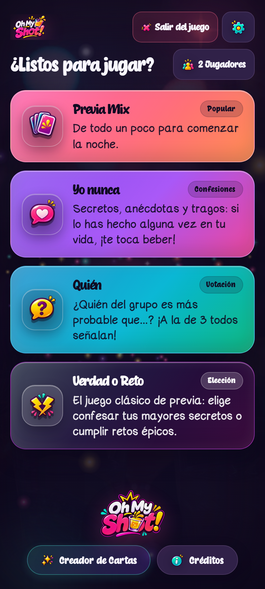
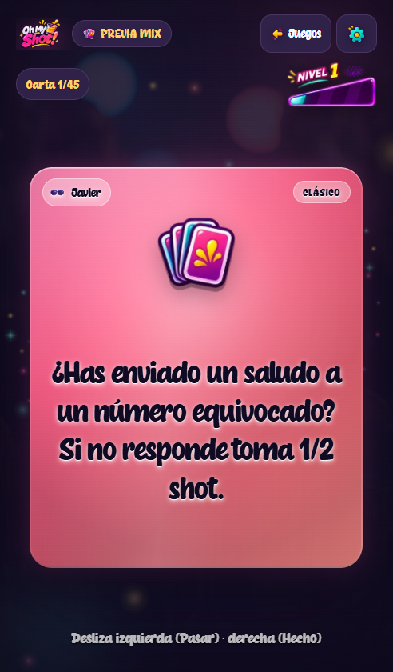
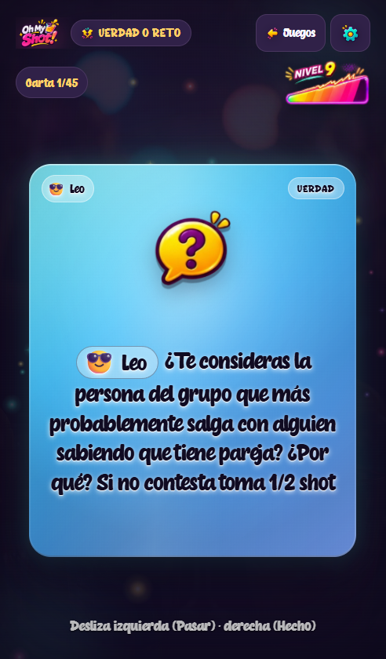
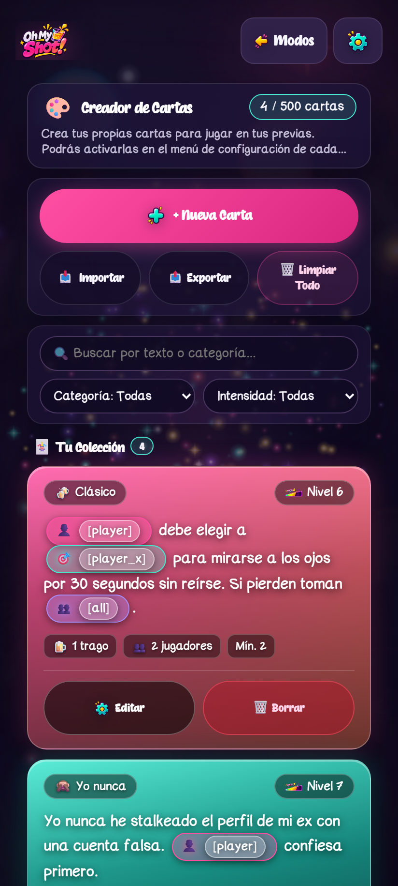
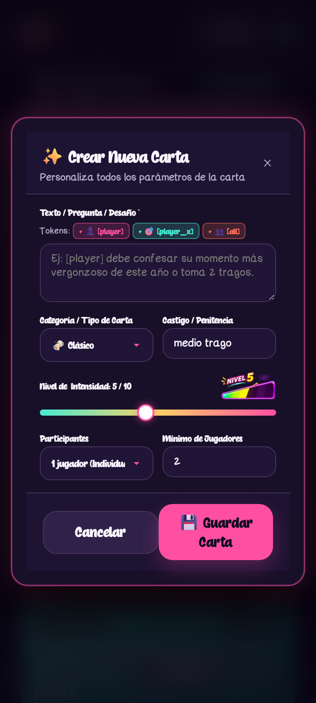
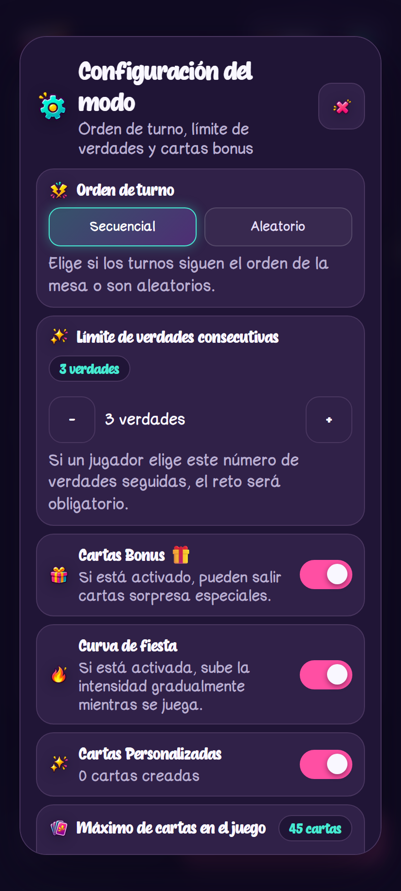

<div align="center">

# 🍻 Oh My Shot!

**La aplicación web progresiva (PWA) definitiva de juegos para previas y fiestas entre amigos.**  
*100% local, interactiva, moderna, sin dependencias pesadas y con estética cyberpunk / neón party.*

[](package.json)
[](manifest.webmanifest)
[](src/main.js)
[](LICENSE)

[🎮 Jugar en Vivo](#-cómo-jugarlo-en-vivo) • [✨ Características](#-características-principales) • [📸 Capturas](#-capturas-de-pantalla) • [🕹️ Modos de Juego](#-modos-de-juego) • [🚀 Ejecución Local](#-instalación-y-ejecución-local)

---

</div>

## 🌐 ¿Cómo Jugarlo En Vivo?

### 1. Directo en tu Navegador (Demo Online)
Puedes jugarlo en vivo desde cualquier dispositivo (celular, tablet o computador) ingresando a:
👉 **[https://leoandrex91.github.io/OhMyShot/](https://leoandrex91.github.io/OhMyShot/)**

> [!TIP]
> **Para activarlo en GitHub Pages**:
> 1. Ve a la pestaña **Settings** de este repositorio en GitHub.
> 2. En el menú lateral izquierdo, haz clic en **Pages**.
> 3. En **Build and deployment** > **Source**, selecciona `Deploy from a branch`.
> 4. Elige la rama `main` y la carpeta `/ (root)`, luego haz clic en **Save**.
> 5. ¡En 1 minuto tu juego estará disponible en línea en la URL anterior!

---

### 2. Despliegue en 1 Clic en Netlify o Vercel
- **Netlify**: El proyecto incluye [netlify.toml](netlify.toml) preconfigurado. Solo conecta este repositorio en Netlify y se desplegará de inmediato.
- **Vercel**: Importa el repositorio como proyecto estático sin configuración adicional.

---

### 3. Instalar como App en tu Celular (PWA Offline)
¡No necesitas descargar nada desde la tienda de aplicaciones ni gastar datos móviles en la fiesta!
1. Abre el enlace en tu navegador móvil (**Chrome** en Android o **Safari** en iOS).
2. Toca el botón de opciones del navegador o el botón **"Instalar App"** en el lobby.
3. Selecciona **"Agregar a la pantalla de inicio"** o **"Instalar aplicación"**.
4. ¡Listo! Tendrás el icono de **Oh My Shot!** en tu pantalla de inicio, a pantalla completa, con soporte de *Screen Wake Lock* (la pantalla no se suspende sola mientras juegas) y **100% funcional sin conexión a internet**.

---

## 📸 Capturas de Pantalla

<div align="center">

| Pantalla de Inicio / Lobby | Selector de Modos de Juego |
| :---: | :---: |
|  |  |

| Selector de Rango de Intensidad (1 - 10) | Partida en Previa Mix con Swipe |
| :---: | :---: |
|  |  |

| Pantalla de Decisión ¿Verdad o Reto? | Carta de Verdad Revelada |
| :---: | :---: |
|  |  |

| Carta de Reto Revelada | Colección del Creador de Cartas |
| :---: | :---: |
|  |  |

| Modal de Crear / Editar Cartas | Ajustes Personalizados por Modo |
| :---: | :---: |
|  |  |

</div>

---

## ✨ Características Principales

- 🃏 **Catálogo Gigante de Cartas**: Más de 2.000 cartas organizadas por tipo, intensidad y número de participantes.
- 🎚️ **Selector de Rango de Intensidad (Nivel 1 al 10)**: Elige un rango dinámico (ejemplo: entre nivel 4-6, solo nivel 6, o entre 7-10 extremo). La curva del juego y las preguntas se adaptan a ese nivel de previa.
- ⚖️ **Modo "Verdad o Reto" con Control de Racha**: Pantalla previa interactiva para que cada jugador decida su destino. Límite configurable de verdades consecutivas (si se llega al límite, la verdad se bloquea y el reto es obligatorio para reiniciar la racha).
- 🎨 **Creador de Cartas Personalizadas (Hasta 500 cartas)**:
  - Pantalla estilo colección con diseño optimizado para celulares en posición vertical.
  - Vista de cartas coloridas idénticas a las originales del juego con insignias para `[player]` y castigos.
  - Creación, edición y eliminación de cartas guardadas en almacenamiento local (`localStorage`).
  - **Exportar e Importar** paquetes de cartas en formato `.json` para compartirlas con tu grupo de amigos.
  - Actívalas o desactívalas a tu gusto en el menú de ajustes de cada modo.
- 🎴 **Animaciones Físicas Fluidas**:
  - Al pasar la carta, la nueva carta entra deslizándose suavemente desde el lado izquierdo con física elástica natural.
  - Controles gestuales táctiles de *swipe* a izquierda (Pasar) y derecha (Hecho) con retroalimentación visual *God / Bad*.
- 🌐 **Soporte Multi-idioma y Regionalización**:
  - Español: Colombia (`es-CO`), México (`es-MX`), España (`es-ES`).
  - Inglés: Estados Unidos (`en-US`), Reino Unido (`en-GB`).
  - Portugués: Brasil (`pt-BR`), Portugal (`pt-PT`).
- 🍻 **Perfiles con y sin Alcohol**: Configura qué jugadores beben alcohol y quiénes no. El motor de castigos adapta dinámicamente las penitencias para que nadie se quede por fuera de la diversión.
- 🎆 **Efectos Visuales y Sonoros Avanzados**:
  - Esfera 3D reactiva de partículas con **Three.js**.
  - Fondo de video ambiental dinámico.
  - Efectos holográficos, confeti en canvas, destellos de lente y audio sintetizado mediante **Web Audio API**.

---

## 🕹️ Modos de Juego

### 1. 🔥 Previa Mix
El modo rey de la previa. Combina preguntas clásicas, duelos 1 vs 1 entre jugadores, rondas HOT +18, eventos especiales globales que cambian las reglas de la mesa y rondas bonus sorpresa con dados interactivos 3D.

### 2. ⚖️ Verdad o Reto
En cada ronda, el jugador activo se enfrenta a una pantalla de decisión: ¿Confesar un secreto íntimo o cumplir un reto épico? Si un jugador elige demasiadas verdades seguidas, el juego bloquea la opción de verdad forzándolo a cumplir un reto para reiniciar su contador. Todas las cartas están optimizadas para un solo jugador protagonista.

### 3. 🙈 Yo Nunca
El clásico juego de fiesta para conocer los secretos más oscuros de tus amigos. Quien lo haya hecho, toma un trago. Incluye progresión de intensidad y eventos grupales.

### 4. 🎯 Quién es Más Probable
Todos señalan a la de tres a la persona del grupo que mejor encaja con la afirmación. Los más votados o el más señalado pagan penitencia.

### 5. 🎨 Creador de Cartas
Crea tus propias preguntas, retos absurdos o bromas internas con tus amigos. Puedes configurar la intensidad (1-10), la categoría, el castigo y el tipo de carta.

---

## 💻 Instalación y Ejecución Local

No requieres Node.js ni pasos de compilación complejos para probar o modificar el juego localmente; está construido en **JavaScript estándar puro (ES Modules)**.

### Opción A: Con Python (Recomendada)
Si tienes Python instalado:
```bash
# 1. Clona el repositorio
git clone https://github.com/leoandrex91/OhMyShot.git
cd OhMyShot

# 2. Inicia un servidor HTTP local
python -m http.server 8080

# 3. Abre en tu navegador:
# http://localhost:8080
```

### Opción B: Con Node.js / NPX
```bash
npx serve .
# o también:
npx http-server -p 8080
```

### Opción C: Con Visual Studio Code o Cursor
1. Abre la carpeta `OhMyShot` en VS Code o Cursor.
2. Instala la extensión **Live Server**.
3. Haz clic derecho sobre `index.html` y selecciona **"Open with Live Server"**.

---

## 📁 Estructura del Proyecto

```text
OhMyShot/
├── assets/                     # Recursos multimedia estáticos
│   ├── audio/                  # Efectos sonoros y pistas ambientales
│   ├── fonts/                  # Fuentes tipográficas oficiales
│   ├── icons/                  # Iconografía UI, dados y barras de niveles
│   ├── imgs/                   # Avatares de jugadores y gráficos
│   └── video/                  # Fondos de video adaptativos
├── docs/
│   └── screenshots/            # Capturas de pantalla para la documentación
├── scripts/                    # Scripts auxiliares y de compilación
│   └── build-netlify.mjs       # Script de build para despliegues en Netlify
├── src/                        # Código fuente modular (Vanilla JS)
│   ├── cards/                  # Catálogos de cartas organizados por locale
│   │   ├── es-CO/              # Packs en Español (Colombia)
│   │   ├── es-MX/              # Packs en Español (México)
│   │   ├── es-ES/              # Packs en Español (España)
│   │   ├── en-US/              # Packs en Inglés (USA)
│   │   ├── pt-BR/              # Packs en Portugués (Brasil)
│   │   └── cards.loader.js     # Cargador perezoso modular de cartas
│   ├── config/                 # Configuración general y tokens de diseño
│   │   └── themeTokens.js      # Colores oficiales, metadatos y versión
│   ├── core/                   # Núcleo del juego
│   │   ├── store.js            # Store de estado reactivo local
│   │   ├── customCards.js      # Almacenamiento e import/export de cartas creadas
│   │   ├── i18n.js             # Diccionario y traducciones (ES, EN, PT)
│   │   └── wakeLock.js         # API para mantener pantalla encendida
│   ├── fx/                     # Efectos visuales, gestos y audio
│   │   ├── audioFx.js          # Síntesis y control de sonido con Web Audio
│   │   ├── stage3d.js          # Escena 3D con partículas Three.js
│   │   ├── swipeController.js  # Control de gestos táctiles y swipe de cartas
│   │   └── visualFx.js         # Confeti, animaciones y destellos de cartas
│   ├── modes/                  # Módulos de cada modo de juego
│   │   ├── previa-mix/         # Adaptador y reglas de Previa Mix
│   │   ├── verdad-o-reto/      # Adaptador, reglas y lógica de Verdad o Reto
│   │   ├── yo-nunca/           # Adaptador de Yo Nunca
│   │   ├── quien/              # Adaptador de Quién es más probable
│   │   └── registry.js         # Registro dinámico de modos
│   ├── styles/                 # Hojas de estilo CSS
│   │   ├── tokens.css          # Variables CSS y tokens de diseño
│   │   ├── global.css          # Estilos base y resets
│   │   └── components.css      # Componentes UI, cartas, animaciones y modales
│   ├── ui/                     # Vistas y componentes de interfaz
│   │   ├── appShell.js         # Controlador maestro de la UI (AppShell)
│   │   ├── cardCreator.js      # Controlador de la pantalla del Creador de Cartas
│   │   └── ...
│   └── main.js                 # Punto de entrada de la aplicación
├── index.html                  # HTML principal de la PWA
├── manifest.webmanifest        # Manifiesto PWA para instalación móvil
├── netlify.toml                # Configuración de despliegue en Netlify
├── package.json                # Metadatos del proyecto (v0.6.0)
└── sw.js                       # Service Worker para funcionamiento 100% offline
```

---

## 🛠️ Tecnologías Utilizadas

- **HTML5 & CSS3 Moderno**: CSS Grid, Flexbox, Container Queries, Variables CSS, Backdrop Filters y animaciones `@keyframes`.
- **JavaScript Moderno (ES6+)**: Módulos nativos (`import`/`export`), `async/await`, Web Animations API.
- **Three.js**: Renderizado 3D acelerado por hardware para efectos de partículas en tiempo real.
- **Web Audio API**: Efectos de sonido sintetizados y música de fondo espacial.
- **Progressive Web App (PWA)**: Cacheo offline con Service Worker y soporte para instalación móvil.
- **Screen Wake Lock API**: Previene el bloqueo o suspensión automática de la pantalla del celular durante la partida.

---

## 👤 Autor

Desarrollado con ❤️ y mucha fiesta por **[leoandre91](https://github.com/leoandrex91)**.

- **GitHub**: [@leoandrex91](https://github.com/leoandrex91)
- **Repositorio**: [https://github.com/leoandrex91/OhMyShot](https://github.com/leoandrex91/OhMyShot)

---

## 📄 Licencia

Este proyecto está bajo la Licencia **MIT**. Consulta el archivo `LICENSE` para más información.
