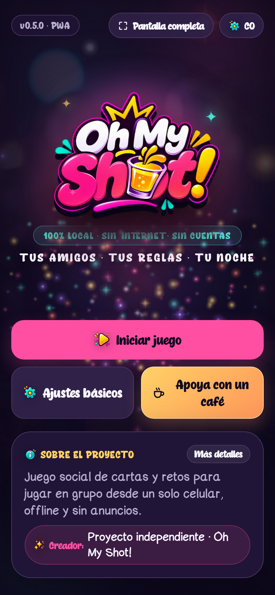
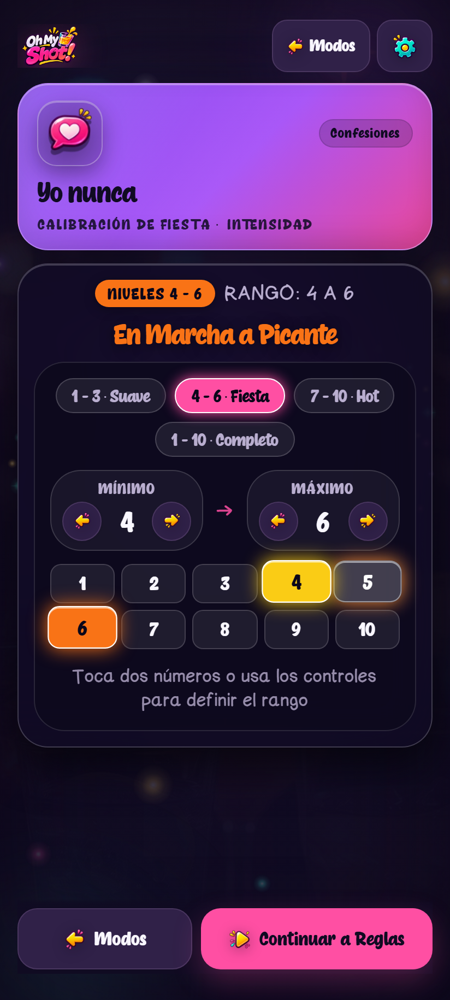
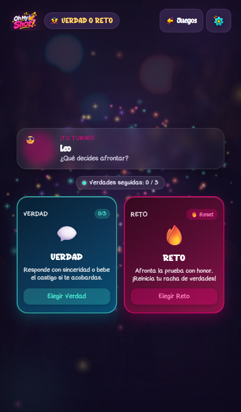
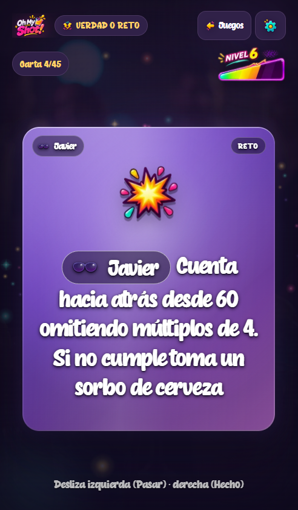

<div align="center">

# 🍻 Oh My Shot!

**La aplicación web progresiva (PWA) definitiva de juegos para previas y fiestas entre amigos.**  
*100% local, interactiva, moderna, sin dependencias pesadas, arquitectura Vanilla ES Modules y estética cyberpunk / neón party.*

[](package.json)
[](manifest.webmanifest)
[](src/main.js)
[-10b981.svg?style=for-the-badge)](src/cards/)
[](LICENSE)

[🎮 Jugar en Vivo](#-cómo-jugarlo-en-vivo) • [✨ Características](#-características-principales) • [📸 Capturas](#-capturas-de-pantalla) • [🕹️ Modos de Juego](#-modos-de-juego) • [🚀 Ejecución Local](#-instalación-y-ejecución-local) • [📁 Arquitectura](#-estructura-del-proyecto)

---

</div>

## 🌐 ¿Cómo Jugarlo En Vivo?

### 1. Directo en tu Navegador (Demo Online)
Puedes jugarlo en vivo desde cualquier dispositivo (celular, tablet o computador) ingresando a:  
👉 **[https://leoandrex91.github.io/OhMyShot/](https://leoandrex91.github.io/OhMyShot/)**

---

### 2. Instalar como App en tu Celular (PWA Offline)
¡No necesitas descargar nada desde tiendas de aplicaciones ni gastar tus datos móviles en la previa!
1. Abre el enlace en tu navegador móvil (**Chrome** en Android o **Safari** en iOS).
2. Toca el menú de opciones del navegador o el botón **"Instalar App"** en el lobby.
3. Selecciona **"Agregar a la pantalla de inicio"** o **"Instalar aplicación"**.
4. ¡Listo! Tendrás el icono de **Oh My Shot!** en tu pantalla de inicio, a pantalla completa, con soporte de *Screen Wake Lock* (la pantalla no se suspende sola mientras juegas) y **100% funcional sin conexión a internet**.

---

## 📸 Capturas de Pantalla

<div align="center">

| Pantalla de Inicio / Lobby | Selector de Modos de Juego |
| :---: | :---: |
|  |  |

| Selector de Rango de Intensidad (1 - 10) | Partida en Previa Mix con Swipe |
| :---: | :---: |
|  |  |

| Pantalla de Decisión ¿Verdad o Reto? | Carta de Verdad Revelada |
| :---: | :---: |
|  |  |

| Modo Cultura Chupística (Rondas) | Ajustes Personalizados de Partida |
| :---: | :---: |
|  |  |

</div>

---

## ✨ Características Principales

- 🃏 **Catálogo Gigante de 19.134 Cartas Activas**:
  - Exactamente **6.378 cartas únicas por idioma**, cuidadosamente catalogadas a lo largo de 11 categorías.
  - Identificadores de cartas estandarizados con prefijo mnemotécnico único por categoría e indexación limpia (`cla_1`, `chup_1`, `ret_1`, `ver_1`, etc.).
- 🌐 **Consolidación en 3 Idiomas Canónicos**:
  - Arquitectura simplificada y limpia con 3 lenguajes puros: **Español (`es`)**, **Inglés (`en`)** y **Portugués (`pt`)**.
  - Selector de idioma en tiempo real desde los ajustes del juego con banderas (🇪🇸, 🇺🇸, 🇧🇷) y persistencia local inmediata.
- ⏳ **Loaders Asíncronos Reales & Precarga Proactiva**:
  - Pantallas de carga reales (`#showScreenLoader`) con anillo de neón, logotipo animado y mensajes dinámicos ("Barajando cartas y preparando mesa...").
  - Precarga de cartas en segundo plano durante la pantalla de bienvenida y el menú de modos, garantizando arranque instantáneo y cero congelamiento en dispositivos móviles.
- 🎚️ **Selector de Rango de Intensidad (Nivel 1 al 10)**:
  - Personaliza la temperatura de la noche eligiendo un rango dinámico (ejemplo: entre 4-6, solo 7, o extremo 8-10). La selección de cartas y el tipo de preguntas se filtran en tiempo real.
- 🍻 **Perfiles con y sin Alcohol (Bebedores y No Bebedores)**:
  - Configura individualmente a cada participante. El motor de castigos adapta dinámicamente las penitencias para que quienes no toman alcohol realicen retos o castigos físicos sin quedar excluidos.
- 🎴 **Física Gestual de Deslizamiento (Swipe)**:
  - Desliza cartas a izquierda o derecha con aceleración natural y retroalimentación háptica / visual (*God / Bad*).
  - Animación elástica de entrada (*slide-in*) al revelar una nueva carta.
- 🎆 **Efectos Audiovisuales Inmersivos**:
  - Esfera 3D interactiva de partículas generada en tiempo real con **Three.js**.
  - Efectos visuales de destellos neón, confeti en canvas y transiciones fluidas.
  - Sonido ambiental dinámico, efectos sintetizados con **Web Audio API** y música especial para cartas HOT +18.
- 📱 **Screen Wake Lock API**:
  - Mantiene la pantalla encendida de forma continua durante toda la partida para que el teléfono no se apague mientras el grupo juega.

---

## 🕹️ Modos de Juego

### 1. 🔥 Previa Mix
El modo rey de la fiesta. Combina dinámicamente 9 tipos de cartas en una sola partida:
- **Clásico**: Preguntas picantes, revelaciones y dinámicas de grupo.
- **Duelo**: Retos 1 contra 1 cara a cara entre jugadores elegidos al azar.
- **Yo Nunca**: Afirmaciones comprometedoras donde quien lo haya hecho debe beber.
- **Quién es Más Probable**: Señalamiento simultáneo del grupo al jugador que mejor encaja con la descripción.
- **Verdad o Reto**: Cartas individuales para confesar o actuar.
- **Eventos Especiales**: Reglas globales que cambian la dinámica de la mesa durante varias rondas.
- **Retos Especiales**: Pruebas físicas y de ingenio de alta dificultad.
- **Modo HOT (+18)**: Cartas de máxima intensidad con música ambiental sensual automática.
- **Rondas Bonus**: Minijuegos sorpresa con dados interactivos 3D.

### 2. 🍻 Cultura Chupística (Caricachupas / Categories)
El juego de categorías tradicional adaptado a la pantalla de tu celular:
- **2.128 cartas temáticas curadas** distribuidas en 10 niveles de intensidad por idioma, 100% libres de ejemplos para evitar spoilers.
- **Cantos rituales interactivos**: Audio y ritmo sincronizados según el idioma (*"Cultura Chupística de..."* / *"Categories of..."*).
- **Deslizamiento universal**: Desliza a cualquier lado para pasar o registrar quién falló.
- **Registro de fallos flexible**: Selector de participante con opción **"Ninguno"** para avanzar de carta limpiamente.
- **Temporizador de turnos configurable**: Tiempo Libre / Infinito (por defecto), 5s, 10s, 15s o personalizado (máximo 60s) con alerta sonora.
- **Podio y Marcador Final**: Pantalla de coronación para la *"🏆 Mente Rápida"* (menos fallos) y el *"🍻 Rey del Shot"* (más fallos).

### 3. ⚖️ Verdad o Reto
Cada jugador en su turno escoge su destino en una pantalla previa interactiva:
- ¿Confesar un secreto íntimo o cumplir un reto épico?
- **Control de racha inteligente**: Límite configurable de verdades consecutivas. Si un jugador supera el límite, la opción de verdad se bloquea y el reto es obligatorio.
- Todas las preguntas están optimizadas para un solo jugador protagonista.

### 4. 🙈 Yo Nunca
El clásico juego social para descubrir secretos. Quien lo haya hecho bebe un shot o cumple la penitencia:
- Progresión de intensidad calibrada por niveles.
- Filtro para cartas picantes (HOT +18).
- Rondas grupales y eventos sorpresa.

### 5. 🎯 Quién es Más Probable
Preguntas directas donde todo el grupo señala a la cuenta de tres:
- Dinámica rápida y participativa.
- Penalizaciones automáticas para el más votado o debate abierto en empates.

### 6. 🔥 Modo Hot (+18)
Modo exclusivo para mayores de edad para subir la temperatura de la noche:
- **500 cartas picantes por idioma** (1.500 cartas HOT exclusivas) calibradas a lo largo de 10 niveles de intensidad.
- Preguntas íntimas individuales (`[player]`), confesiones picantes y retos en pareja (`[player] y [player_x]`).
- Música ambiental sensual continua (`music_hot_bg.m4a`), estética visual de fuego/neón y efectos inmersivos.
- Verificación prioritaria de mayoría de edad (+18).

---

## 🎨 Creador de Cartas Personalizadas (Card Creator)

Diseña tus propias cartas y personaliza la experiencia con bromas locales, preguntas privadas o desafíos entre amigos:
- **Soporte Completo de las 11 Categorías**: Crea cartas para cualquiera de los estilos del juego (`Clásico`, `Cultura Chupística`, `Yo nunca`, `¿Quién es más probable?`, `Verdad`, `Reto`, `Reto especial`, `Duelo`, `Hot +18`, `Evento especial`, `Bonus`).
- **Plantillas Dinámicas con Tokens**: Inserta fácilmente marcadores como `[player]` (jugador protagonista), `[player_x]` (segundo jugador) o `[all]` (todo el grupo) para que el motor asigne automáticamente los participantes durante la partida.
- **Configuración Completa de Parámetros**: Define texto o tema, nivel de intensidad (1 a 10), castigo o trago sugerido, participantes (1, 2, 3 o grupo) y mínimo de jugadores en mesa.
- **Integración Nativa en Todos los Modos**: Activa o desactiva tus cartas creadas desde el modal de ajustes de cada modo (Previa Mix, Cultura Chupística, Verdad o Reto, etc.). Las cartas personalizadas aparecen con el distintivo `⭐ CUSTOM`.
- **Exportación e Importación JSON**: Respalda tu colección completa o compártela con tus amigos en un archivo `.json` liviano. Capacidad de almacenamiento persistente en `localStorage` de hasta 500 cartas.

---

## 💻 Instalación y Ejecución Local

No necesitas instalar Node.js ni configurar herramientas complejas de compilación (Webpack, Vite, etc.). La aplicación corre 100% sobre **JavaScript estándar puro (ES Modules)**.

### Opción A: Con Python (Recomendada)
```bash
# 1. Clona el repositorio
git clone https://github.com/leoandrex91/OhMyShot.git
cd OhMyShot

# 2. Inicia un servidor HTTP local en el puerto 8080
python -m http.server 8080

# 3. Abre en tu navegador favorito:
# http://localhost:8080
```

### Opción B: Con Node.js / NPX
```bash
npx serve .
# o también:
npx http-server -p 8080
```

### Opción C: Con Visual Studio Code
1. Abre la carpeta `OhMyShot` en VS Code.
2. Instala la extensión **Live Server**.
3. Haz clic derecho sobre `index.html` y selecciona **"Open with Live Server"**.

---

## 📁 Estructura del Proyecto

```text
OhMyShot/
├── assets/                     # Recursos multimedia estáticos
│   ├── audio/                  # Pistas musicales (.m4a) y efectos sonoros sintetizados
│   ├── fonts/                  # Fuentes tipográficas oficiales
│   ├── icons/                  # Iconografía UI, dados y barras de niveles
│   ├── imgs/                   # Avatares de jugadores y recursos gráficos
│   └── video/                  # Fondos de video ambientales
├── docs/
│   └── screenshots/            # Capturas de pantalla para la documentación
├── scripts/                    # Scripts auxiliares y herramientas de desarrollo
├── src/                        # Código fuente modular (Vanilla JS ES Modules)
│   ├── cards/                  # Catálogos canónicos de cartas
│   │   ├── es/                 # Catálogo en Español (11 archivos temáticos)
│   │   ├── en/                 # Catálogo en Inglés (11 archivos temáticos)
│   │   ├── pt/                 # Catálogo en Portugués (11 archivos temáticos)
│   │   ├── bonus.catalog.js    # Definiciones de dados y rondas bonus
│   │   ├── castigos.catalog.js # Castigos dinámicos (bebedores y no bebedores)
│   │   └── cards.loader.js     # Cargador asíncrono y precarga de cartas
│   ├── config/                 # Constantes, tokens de diseño y metadatos
│   │   ├── constants.js        # Constantes globales del juego
│   │   └── themeTokens.js      # Colores oficiales, versión (v0.8.1) y tema
│   ├── core/                   # Módulos de infraestructura y estado
│   │   ├── store.js            # Almacén de estado reactivo local
│   │   ├── i18n.js             # Motor de internacionalización y diccionarios (ES, EN, PT)
│   │   ├── soundEngine.js      # Motor centralizado de música y sonido
│   │   └── wakeLock.js         # API para mantener la pantalla activa
│   ├── fx/                     # Efectos visuales, gestos y audio
│   │   ├── audioFx.js          # Síntesis de sonido con Web Audio API
│   │   ├── stage3d.js          # Escena 3D con partículas Three.js
│   │   ├── swipeController.js  # Control de gestos táctiles y swipe de cartas
│   │   └── visualFx.js         # Confeti en canvas, destellos y animaciones
│   ├── modes/                  # Módulos y adaptadores de cada modo de juego
│   │   ├── previa-mix/         # Adaptador, reglas y fases de Previa Mix
│   │   ├── cultura-chupistica/ # Adaptador, cantos, timer y podio de Cultura Chupística
│   │   ├── verdad-o-reto/      # Adaptador y lógica de rachas de Verdad o Reto
│   │   ├── yo-nunca/           # Adaptador de Yo Nunca
│   │   ├── quien/              # Adaptador de Quién es más probable
│   │   └── registry.js         # Registro dinámico de modos de juego
│   ├── styles/                 # Hojas de estilo CSS modulares
│   │   ├── tokens.css          # Variables CSS y tokens de diseño
│   │   ├── global.css          # Estilos base y resets
│   │   └── components.css      # Componentes UI, cartas, animaciones y modales
│   ├── ui/                     # Vistas y componentes de interfaz
│   │   └── appShell.js         # Orquestador maestro de vistas y navegación (AppShell)
│   └── main.js                 # Punto de entrada de la aplicación
├── index.html                  # HTML principal de la PWA
├── manifest.webmanifest        # Manifiesto PWA para instalación en Android / iOS
├── package.json                # Metadatos del proyecto (v0.8.1)
├── CHANGELOG.md                # Historial completo de versiones y cambios
└── sw.js                       # Service Worker para funcionamiento 100% offline
```

---

## 🛠️ Tecnologías Utilizadas

- **HTML5 & CSS3 Moderno**: CSS Grid, Flexbox, Container Queries, Variables CSS, Backdrop Filters y animaciones `@keyframes`.
- **JavaScript Moderno (ES6+)**: Módulos nativos (`import`/`export`), `async/await`, Web Animations API.
- **Three.js**: Renderizado 3D acelerado por hardware para efectos de partículas en tiempo real.
- **Web Audio API**: Efectos de sonido sintetizados y música ambiental dinámica.
- **Progressive Web App (PWA)**: Cacheo offline integral con Service Worker y soporte para instalación móvil.
- **Screen Wake Lock API**: Previene el bloqueo o suspensión automática de la pantalla del celular durante la partida.

---

## 📜 Registro de Cambios (Changelog)

Consulta el historial detallado de todas las versiones, mejoras y correcciones desde la `v0.1.0` hasta la última versión en [CHANGELOG.md](CHANGELOG.md).

---

## 👤 Autor

Desarrollado con ❤️ y mucha fiesta por **[leoandre91](https://github.com/leoandrex91)**.

- **GitHub**: [@leoandrex91](https://github.com/leoandrex91)
- **Repositorio**: [https://github.com/leoandrex91/OhMyShot](https://github.com/leoandrex91/OhMyShot)

---

## 📄 Licencia y Términos de Uso

Este proyecto se distribuye bajo una licencia **Libre de Uso y No Comercial** ([CC BY-NC-SA 4.0](LICENSE) / OMS-NC).

- ✅ **Uso Libre y Gratuito**: Cualquiera puede jugar, ejecutar, disfrutar, traducir y compartir el juego libremente para uso personal, en previas, fiestas, reuniones, eventos comunitarios o educativos.
- ✅ **Libre Distribución y Modificación**: Puedes clonar, bifurcar (*fork*), modificar el código y aportar mejoras, siempre que mantengas la atribución al autor original y compartas bajo estos mismos términos.
- ❌ **Uso Comercial Prohibido**: **Está estrictamente prohibido utilizar este código, cartas o recursos para crear juegos o aplicaciones con el fin de cobrar por ellos**, vender descargas, incluir pasarelas de pago, suscripciones de pago o cualquier tipo de monetización lucrativa. Cualquier juego derivado debe ser siempre 100% libre y gratuito.

Para más detalles, consulta el archivo [LICENSE](LICENSE).
